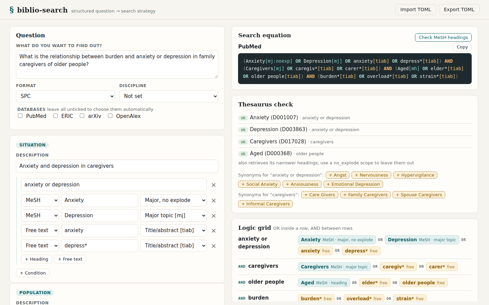
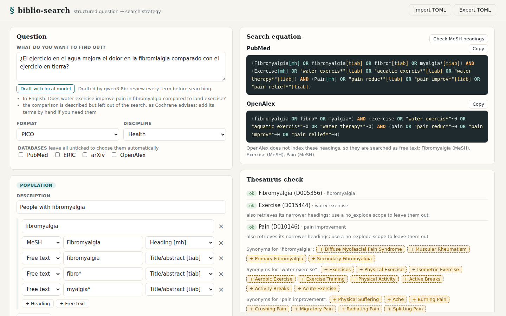
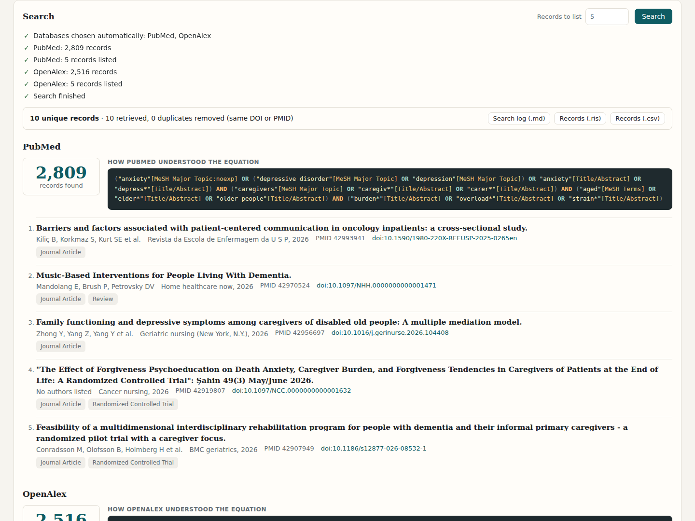
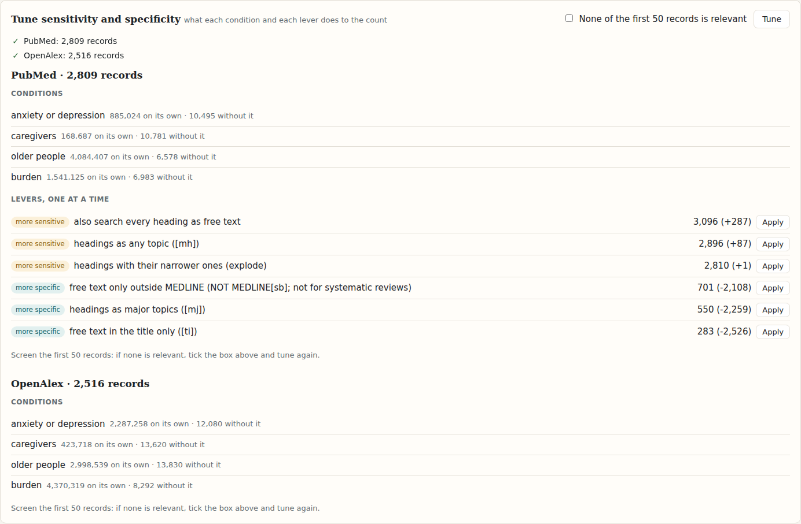
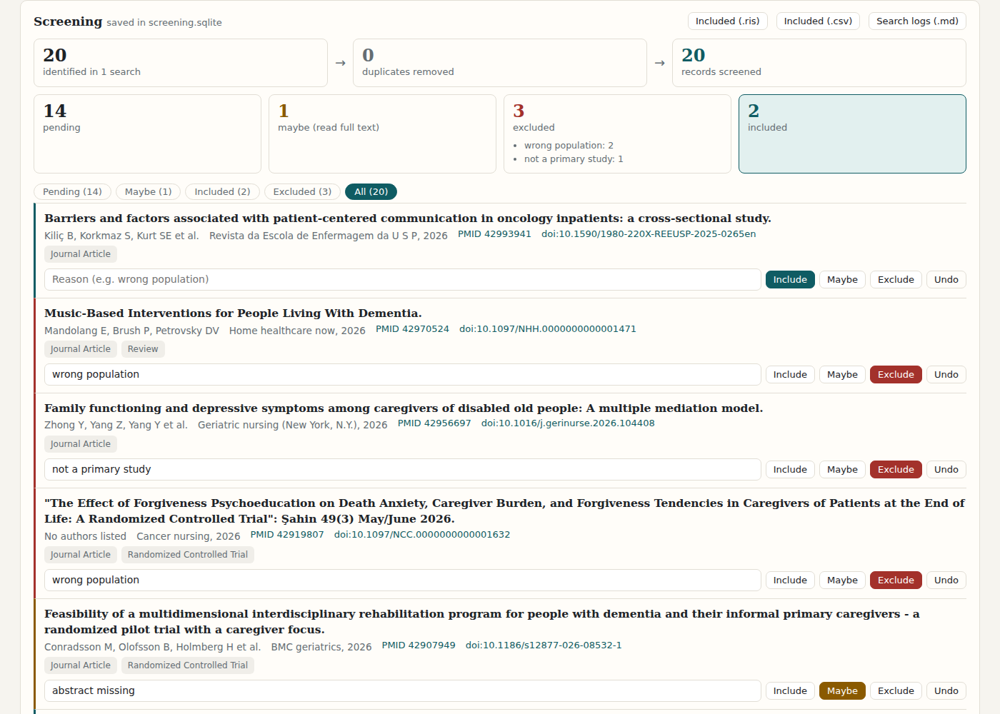

# biblio-search

Turn a research question from any discipline into a rigorous, reproducible search strategy,
and run it in PubMed and OpenAlex.

biblio-search models the bibliographic search method taught to health-science students, and
extends it to any field:
decompose the question, map every concept to controlled vocabulary and free text, tag each
term with the right field, and assemble everything into a single boolean equation whose
sensitivity and specificity you can tune on purpose instead of by trial and error.

Everything happens in a local web page: write the question, watch the equation, the logic
grid and the chosen databases update as you type, check the headings against MeSH and run the
search with live progress, then screen the records it found, deciding on each one with its
reason in a file you can come back to. The same features are available from the command line.



## What problem it solves

Writing a good PubMed search by hand is error prone. AND and OR are evaluated left to right,
so a missing parenthesis silently changes the meaning of the whole query. MeSH headings
explode into their subcategories unless told otherwise, and free-text terms are searched in
every field unless restricted to title and abstract. Multi-word truncation only works inside
quotes, but quoting everything makes the search too narrow. These are exactly the details
that end up wrong in coursework, final-year projects and quick clinical look-ups.

biblio-search lets you describe the question once, as data, and generates the equation
following explicit rules. The question file documents the search, so the same strategy can be
rerun, reviewed or adjusted later.

## The method

The tool follows the approach described by Rafael del Pino Casado (Department of Nursing,
University of Jaén) in *"Cómo aprender (y enseñar) a realizar búsquedas en CINAHL y PubMed"*
(Evidentia, 2017):

1. **Structure the question.** Use **SPC** (health *Situation*, *Population*, study
   *Question*), which fits any study design, or **PICO** (*Population*, *Intervention*,
   *Comparison*, *Outcome*) for intervention studies. A PICO element can be described and
   left out of the search, as the Cochrane Handbook recommends. Outside health, describe
   the question as a list of free **concepts**.
2. **Choose the databases.** Selecting where to search is the first decision of the
   strategy. biblio-search picks them with fixed rules and says why, or takes your choice.
3. **Turn components into conditions.** Every condition is something each retrieved record
   must satisfy; conditions are joined with **AND**.
4. **Fill every condition with terms.** Controlled headings (MeSH) plus free-text synonyms
   with truncation; the terms of a condition are alternatives joined with **OR**.
5. **Confirm the headings in the thesaurus.** A MeSH heading is only useful if it exists:
   biblio-search looks every controlled term up in NCBI's MeSH database, points entry terms
   to their descriptor and searches anything that is not a heading as free text.
6. **Tag every term.** Headings get `[mh]`, `[mj]`, `[mh:noexp]` or `[mj:noexp]`, from most to
   least sensitive; free text gets `[tiab]` or `[ti]`.
7. **Tune sensitivity and specificity.** Repeat headings as free text to catch records not
   yet indexed, or limit free text to non-MEDLINE records with `NOT MEDLINE[sb]` for a more
   specific search. Del Pino gives two warnings: distrust fewer than 100 records on a topic
   with enough scientific output (too specific), and if none of the first 50 records is
   relevant, the search is probably too sensitive. biblio-search counts every condition and
   every lever so you tune with numbers.
8. **Run it and read what the database understood.** biblio-search sends each database its
   own equation (PubMed through NCBI E-utilities, OpenAlex through its works API) and shows
   the record count, the database's own reading of the query, any term it did not recognise
   and the first records to screen.

## Engineering highlights

- **The domain is the validation layer.** Invalid searches cannot be represented: truncated
  MeSH headings, stray asterisks, embedded quotes or brackets, repeated terms, components that
  do not belong to the chosen format, or a question with nothing to search all raise a
  `QuestionError` with a precise message.
- **Quoting is decided, not guessed.** Terms are quoted only when PubMed would otherwise
  misread them (commas, parentheses, words like `and`/`or`/`not`, or truncated phrases),
  because unnecessary quotes reduce recall.
- **PubMed is never trusted blindly.** PubMed silently remaps headings and drops broken
  syntax (an unbalanced parenthesis simply disappears). Every search prints the query
  translation and surfaces NCBI's `phrasesnotfound` and warning lists.
- **Headings are checked, never assumed.** `check` confirms every controlled term against
  the MeSH database (`db=mesh`), maps entry terms such as *Carers* to their descriptor
  (*Caregivers*), discards subheadings that share the index, and rewrites MeSH entry terms
  into the natural, comma-free synonyms an author would actually write. The lookup sits
  behind a `Thesaurus` protocol so other vocabularies can plug in.
- **Spanish headings, still confirmed in MeSH.** With a DeCS licence key, a heading written
  in Spanish (*Músculos*, *Tejido Muscular*) is looked up in DeCS, which keeps the NLM
  identifier of every descriptor it translates, and the English name it gives is confirmed
  in MeSH like any other heading. Only an exact Spanish name or synonym is renamed; a text
  that merely shares words with a descriptor is left alone.
- **A local model drafts, the thesaurus decides.** The optional assistant asks a model
  running on your own machine through Ollama (no paid API, the question never leaves it) to
  decompose a sentence into SPC, PICO or free concepts. It answers through a JSON schema with
  one fixed key per component, so small models cannot skip one; terms the question format
  would reject are left out with a note, and every MeSH heading it proposes goes through the
  same check as a hand-written one, so an invented descriptor ends up as free text.
- **Database choice is explained, not magic.** The automatic choice is a handful of
  deterministic rules (MeSH headings or an SPC/PICO question lead to PubMed, an education
  question or ERIC descriptors to ERIC, exact sciences to arXiv, OpenAlex always), and every
  database comes with the reasons it was picked, ready to copy into a methods section.
- **Every heading knows its thesaurus.** Controlled terms carry their vocabulary (MeSH by
  default, ERIC). A database that does not index a vocabulary searches those headings as
  free text and says so, and each thesaurus only checks its own headings.
- **OpenAlex searched as written.** OpenAlex stems its default search, which turns *carer*
  into *care* and multiplies the results tenfold, and rejects wildcards there. biblio-search
  uses its unstemmed title-and-abstract search instead, so terms mean what they mean in
  PubMed's `[tiab]`, and writes truncated phrases (`family caregiv*`), which OpenAlex refuses
  inside quotes, as zero-distance proximity (`"family caregiv*"~0`). OpenAlex indexes no
  thesaurus, so headings become free text, and each database explains in a note anything it
  had to search differently from how the question was written.
- **One record per work, whatever the database.** Records from every database are merged
  by DOI or PMID (OpenAlex knows the PMID of the works PubMed indexes), never by title,
  because two different works can share one and a wrong merge would hide a record from the
  screening. A record that shares its DOI with one group and its PMID with another joins both.
- **A search that can be repeated.** Every run can be saved as a Markdown log with the date,
  tool version, databases and why they were chosen, each equation and how the database read
  it, the counts, the duplicates removed, and the question itself as TOML next to the exact
  command that runs it again. Records export to RIS (CRLF lines, as the format asks) and to
  CSV with a BOM for Excel and cells that cannot be read as formulas.
- **Screening that survives a closed laptop.** Decisions live in a local SQLite file and are
  written the moment they are made, so screening stops and resumes at any record. A second
  search adds only the works the first one did not find (same DOI, PMID or database id), and
  two records already kept are never fused, so no decision is ever lost. The counts of a
  PRISMA-style flow diagram, exclusion reasons included, are read straight from the file.
- **Records are database-neutral.** A search returns ids and a second call fetches their
  summaries, in the same order, for every database; each record keeps its own identifier
  (PMID or OpenAlex work id) and link, so the CLI and the page list them side by side.
- **A polite async client.** The E-utilities client is built on `httpx.AsyncClient`, spaces
  requests to NCBI's quota (3 per second, 10 with an API key), always identifies the tool,
  retries 429/5xx and network errors with backoff (honouring `Retry-After`, including NCBI's
  rate-limit errors served with HTTP 200) and batches summary requests. The OpenAlex client
  works the same way within OpenAlex's limits (1 request per second for long boolean queries
  without a key, 5 with one), sends the optional key in a header rather than the URL, and
  stops early with a clear message when the daily budget is spent instead of waiting hours.
- **Offline, deterministic tests.** Real NCBI and OpenAlex responses are recorded as fixtures and an
  autouse guard makes any test that opens a socket fail.
- **Dialects behind a protocol.** Query generation sits behind a small `QueryDialect`
  interface, so other databases can get their own syntax without touching the model.
- **A local web interface without a build step.** FastAPI serves a single page written in
  plain HTML, CSS and JavaScript, so `pip install` is all it takes. The page draws exactly
  what the CLI computes (same equations, same reasons), and searches stream their progress
  as Server-Sent Events: equation sent, count received, records listed.
- **Local means local.** The server binds to `127.0.0.1` only and also refuses foreign
  `Host` headers (DNS rebinding), foreign `Origin` headers and non-JSON bodies, so other
  websites open in the same browser cannot drive it. All user text is rendered as text,
  never as HTML.
- **Strict typing, few dependencies.** Frozen dataclasses and enums, `mypy --strict` on
  sources and tests; beyond the standard library, `httpx` for NCBI and OpenAlex, and FastAPI with uvicorn
  for the web interface. Question files are read with `tomllib` and written back by a small
  serializer of their own.

## Architecture

```text
biblio-search/
├── src/biblio_search/
│   ├── models.py         # SPC/PICO/concepts question, conditions, terms, vocabularies
│   ├── protocols.py      # QueryDialect and Thesaurus interfaces
│   ├── pubmed_query.py   # PubMed field tags, quoting rules and equation assembly
│   ├── openalex_query.py # OpenAlex equation: unstemmed title/abstract search, proximity
│   ├── question_file.py  # TOML question files -> validated domain objects
│   ├── ratelimit.py      # async requests-per-second limiter
│   ├── eutils.py         # NCBI E-utilities client (esearch, esummary) and response parsing
│   ├── openalex.py       # OpenAlex works client (search, summaries) and response parsing
│   ├── mesh.py           # MeSH lookups through E-utilities (db=mesh)
│   ├── decs.py           # DeCS client and the Spanish-to-MeSH bridge (optional, licensed)
│   ├── check.py          # heading checks, synonym suggestions, unknown terms to free text
│   ├── assistant.py      # optional Ollama assistant: a sentence -> a checked question draft
│   ├── selection.py      # rule-based database choice with reasons, manual override
│   ├── catalog.py        # databases, vocabularies and labels shared by the CLI and the web
│   ├── pipeline.py       # question -> equation -> search -> records, step by step
│   ├── tuning.py         # condition and lever counts, Del Pino's sensitivity warnings
│   ├── merge.py          # union of several databases without duplicates (DOI or PMID)
│   ├── search_log.py     # reproducible Markdown log of a search
│   ├── export.py         # merged records as RIS and CSV
│   ├── screening.py      # SQLite screening project: decisions, reasons and flow counts
│   ├── web/
│   │   ├── app.py        # FastAPI app: preview, check, SSE search, tuning, downloads, screening
│   │   ├── views.py      # JSON views of questions, selections, counts and records
│   │   ├── server.py     # binds 127.0.0.1 and opens the browser
│   │   └── static/       # the page: HTML, CSS and JavaScript, no build step
│   └── __main__.py       # command line interface (ui, draft, build, check, decs, databases, search, tune, screening)
├── examples/
│   ├── caregiver-burden.toml       # worked example from Del Pino (2017)
│   └── peer-tutoring-reading.toml  # education question with free concepts and ERIC terms
└── tests/                # unit tests and recorded NCBI, OpenAlex, DeCS and Ollama fixtures, no network access
```

## Installation

Requires Python 3.11 or newer.

```bash
git clone https://github.com/juanmmm21/biblio-search.git
cd biblio-search
python -m venv .venv
source .venv/bin/activate
pip install -e .
```

## Usage

### The web interface

```bash
biblio-search ui                                  # empty question
biblio-search ui examples/caregiver-burden.toml   # open a question file
```

The page opens in your browser on a free port of `127.0.0.1` (`--port` to fix it,
`--no-browser` to just print the address). Nobody else on the network can reach it.

- **Draft it from a sentence** (optional): write the question in Spanish or English and
  *Draft with local model* fills in the format, the components and their terms, with the MeSH
  headings already checked. See [Drafting a question with a local model](#drafting-a-question-with-a-local-model).
- **Write the question** as SPC, PICO or free concepts. Every condition holds its terms:
  MeSH or ERIC headings with their scope, and free text with its field.
- **Watch the strategy take shape**: the highlighted equation with a copy button, Del Pino's
  logic grid (one row per condition, OR inside a row, AND between rows, exclusions with NOT),
  the chosen databases with the reasons, and the question tree.
- **Check the MeSH headings**: each one is confirmed, corrected or flagged, with suggested
  synonyms you can add with a click and a button that applies the corrections.
- **Tune** the strategy: the count of every condition on its own and without it, and of
  every lever of the method moved one at a time, with Del Pino's warnings and an *Apply*
  button that loads the variant you prefer into the form.
- **Search** every chosen database and follow each step live. Each database gets its own
  block: the record count, how it read its equation and the first records, with links to
  PubMed or OpenAlex and to the DOI. When it finishes, the records of every database are
  merged without duplicates and you can download the search log, and the records as RIS
  or CSV.
- **Screen** the records: *Add to screening* sends a finished search to the screening panel,
  where each record gets *Include*, *Maybe* or *Exclude* with an optional reason (reasons you
  already used are offered as you type). The flow diagram on top counts records identified,
  duplicates removed, screened, pending, maybe, excluded by reason and included, and the
  included records download as RIS or CSV.
- **Import and export** the question as a TOML file, the same format the CLI reads.









### Question files and the command line

Describe the question in a TOML file. This is the worked example from Del Pino's article:
*What is the relationship between burden and anxiety or depression in family caregivers of
older people?*

```toml
question = "What is the relationship between burden and anxiety or depression in family caregivers of older people?"
format = "spc"

[[components]]
role = "situation"
description = "Anxiety and depression in caregivers"

[[components.conditions]]
label = "anxiety or depression"
controlled = [
    { term = "Anxiety", scope = "major_no_explode" },
    { term = "Depression", scope = "major" },
]
free = ["anxiety", "depress*"]

[[components]]
role = "population"
description = "Family caregivers of older people"

[[components.conditions]]
label = "caregivers"
controlled = [{ term = "Caregivers", scope = "major" }]
free = ["caregiv*", "carer*"]

[[components.conditions]]
label = "older people"
controlled = ["Aged"]
free = ["elder*", "older people"]

[[components]]
role = "question"
description = "Relationship with caregiver burden"

[[components.conditions]]
label = "burden"
free = ["burden*", "overload*", "strain*"]
```

Build the equation and paste it into PubMed:

```console
$ biblio-search build examples/caregiver-burden.toml
(Anxiety[mj:noexp] OR Depression[mj] OR anxiety[tiab] OR depress*[tiab]) AND (Caregivers[mj] OR caregiv*[tiab] OR carer*[tiab]) AND (Aged[mh] OR elder*[tiab] OR older people[tiab]) AND (burden*[tiab] OR overload*[tiab] OR strain*[tiab])
```

`Aged` keeps its default `[mh]` scope on purpose: exploding it also retrieves
*Aged, 80 and over*, which the population needs.

Make the search more specific by limiting free text to records not yet indexed in MEDLINE,
and more sensitive by repeating every heading as free text. Headings already covered by a
truncated synonym (`Caregivers` by `caregiv*`) are not repeated:

```console
$ biblio-search build examples/caregiver-burden.toml --unindexed-only --repeat-controlled-as-free
(Anxiety[mj:noexp] OR Depression[mj] OR ((anxiety[tiab] OR depress*[tiab]) NOT MEDLINE[sb])) AND (Caregivers[mj] OR ((caregiv*[tiab] OR carer*[tiab]) NOT MEDLINE[sb])) AND (Aged[mh] OR ((elder*[tiab] OR older people[tiab] OR aged[tiab]) NOT MEDLINE[sb])) AND (burden*[tiab] OR overload*[tiab] OR strain*[tiab])
```

The MEDLINE filter is only applied to conditions that also have headings, so a free-text-only
condition never loses the indexed records. Avoid it for systematic reviews, which need the
extra sensitivity.

### Checking headings against MeSH

`check` looks up every controlled term in NCBI's MeSH database before you search:

```console
$ biblio-search check examples/caregiver-burden.toml
MeSH check of 4 controlled terms
  ok          Anxiety (D001007) [anxiety or depression]
  ok          Depression (D003863) [anxiety or depression]
  ok          Caregivers (D017028) [caregivers]
  ok          Aged (D000368) [older people]
              also retrieves its narrower headings; use a no_explode scope to leave them out

Synonyms you could add as free text:
  anxiety or depression: Angst, Nervousness, Hypervigilance, Social Anxiety, Anxiousness, Emotional Depression
  caregivers: Care Givers, Family Caregivers, Spouse Caregivers, Informal Caregivers

Equation after the check: (Anxiety[mj:noexp] OR Depression[mj] OR anxiety[tiab] OR depress*[tiab]) AND (Caregivers[mj] OR caregiv*[tiab] OR carer*[tiab]) AND (Aged[mh] OR elder*[tiab] OR older people[tiab]) AND (burden*[tiab] OR overload*[tiab] OR strain*[tiab])
```

- **ok**: the term is a MeSH descriptor. A note tells you when the scope matters: a heading
  with narrower headings explodes unless you pick a `*_no_explode` scope, and a no-explode
  scope on a heading without narrower ones changes nothing.
- **entry term**: the text is a synonym of a descriptor (`Carers -> Caregivers (D017028)`);
  the corrected equation uses the descriptor.
- **not found**: the text is not a MeSH heading, so it is searched as free text instead of
  silently matching nothing as `[mh]`.

Suggested synonyms come from the descriptor's entry terms, put back in natural order
(*Depression, Emotional* becomes *Emotional Depression*) and left out when a free term you
already have covers them (`caregiv*` covers *Caregiver*). Nothing is written to your file:
copy the ones that fit your question.

Only MeSH headings are sent to MeSH. Headings from other vocabularies (ERIC descriptors) are
listed under `Not checked` and left exactly as written.

### Spanish headings through DeCS

[DeCS](https://decs.bvsalud.org/en/) (Descriptores en Ciencias de la Salud, BIREME/PAHO/WHO)
is MeSH translated into Spanish and Portuguese. Its API is free, but every user needs their
own licence key, requested through the
[DeCS developers page](https://decs.bvsalud.org/en/for-developers/). biblio-search works
without it; with it, set the key in the environment:

```bash
export DECS_API_KEY="..."             # optional, read from the environment only
```

From then on `check` (and the *Check MeSH headings* button of the web interface) looks up in
DeCS every heading MeSH does not know, and renames the exact Spanish ones to their MeSH
descriptor:

```console
  in Spanish  Músculos -> Muscles (D009132) [muscles]: found through DeCS
```

To explore a concept before writing the question, `decs` lists every MeSH descriptor DeCS
finds for a Spanish term, exact matches first, each one confirmed in MeSH:

```console
$ biblio-search decs tejido muscular
MeSH descriptors for 'tejido muscular' (through DeCS, confirmed in MeSH):
  exact   Músculos -> Muscles (D009132)
```

DeCS is © BIREME/PAHO/WHO and is used here under its licence conditions; the descriptors
shown are those of the DeCS edition its API serves.

### Drafting a question with a local model

biblio-search can ask a language model running on your own computer to draft the question
for you. It is optional and free: the model runs in [Ollama](https://ollama.com), nothing is
sent to any online service, and everything else works the same without it.

```bash
ollama pull qwen3:8b                  # once; any model with structured outputs works
export BIBLIO_SEARCH_MODEL=qwen3:8b   # optional, qwen3:8b is the default
```

```console
$ biblio-search draft --output fibromyalgia.toml "¿El ejercicio en el agua mejora el dolor en la fibromialgia comparado con el ejercicio en tierra?"
Draft by qwen3:8b (local, through Ollama): review it before searching.
Discipline: health · format: pico
In English: Does water exercise improve pain in fibromyalgia compared to land exercise?
  population: People with fibromyalgia
    fibromyalgia: Fibromyalgia [MeSH], fibromyalgia, fibro*, myalgia*
  intervention: Water exercise
    water exercise: Exercise [MeSH], water exercis*, aquatic exercis*, water therapy*
  comparison: Land exercise
    (not searched)
  outcome: Pain reduction
    pain improvement: Pain [MeSH], pain reduc*, pain improv*, pain relief*

Changed from what the model proposed:
  the comparison is described but left out of the search, as Cochrane advises; add its terms by hand if you need them

MeSH check of 3 controlled terms
  ok          Fibromyalgia (D005356) [fibromyalgia]
  ok          Exercise (D015444) [water exercise]
              also retrieves its narrower headings; use a no_explode scope to leave them out
  ok          Pain (D010146) [pain improvement]
              also retrieves its narrower headings; use a no_explode scope to leave them out
...
Equation after the check: (Fibromyalgia[mh] OR fibromyalgia[tiab] OR fibro*[tiab] OR myalgia*[tiab]) AND (Exercise[mh] OR "water exercis*"[tiab] OR "aquatic exercis*"[tiab] OR "water therapy*"[tiab]) AND (Pain[mh] OR "pain reduc*"[tiab] OR "pain improv*"[tiab] OR "pain relief*"[tiab])

Question file written to fibromyalgia.toml

Next: biblio-search databases fibromyalgia.toml
```

The model first classifies the question (discipline, and SPC for health questions about
experiences or relationships, PICO for the effect of an intervention, free concepts outside
health) and then decomposes it into the components of that format, with English headings
and free text. `--discipline` and `--format` keep your own choice instead. The draft is then
checked against MeSH like any question: headings MeSH does not know are searched as free
text. Without `--output` the question file is printed. In the web interface the
*Draft with local model* button does the same and loads the draft into the form.

A small local model is a starting point, not a librarian: read every condition, merge or
split the ones it got wrong and add the synonyms you know before searching. `OLLAMA_HOST`
points to an Ollama on another machine, and the model is unloaded a minute after the draft
so it does not keep the GPU busy.

### Choosing the databases

`databases` shows where a question will be searched, why, and the equation of every database
it can query:

```console
$ biblio-search databases examples/caregiver-burden.toml
Databases (chosen automatically):
  PubMed
    - the question uses MeSH headings
    - SPC is a health-science question format
  OpenAlex
    - general multidisciplinary database, so nothing outside the specialised ones is missed

PubMed equation: (Anxiety[mj:noexp] OR Depression[mj] OR anxiety[tiab] OR depress*[tiab]) AND (Caregivers[mj] OR caregiv*[tiab] OR carer*[tiab]) AND (Aged[mh] OR elder*[tiab] OR older people[tiab]) AND (burden*[tiab] OR overload*[tiab] OR strain*[tiab])

OpenAlex equation: (anxiety OR depress*) AND (caregiv* OR carer*) AND (aged OR elder* OR "older people") AND (burden* OR overload* OR strain*)
Note: OpenAlex does not index these headings, so they are searched as free text: Anxiety (MeSH), Depression (MeSH), Caregivers (MeSH), Aged (MeSH)
```

The rules are deterministic, so the same question always gets the same databases:

- **PubMed** when the question uses MeSH headings, is written as SPC or PICO, or its
  `discipline` is `health`.
- **ERIC** when the `discipline` is `education` or the question uses ERIC descriptors.
- **arXiv** when the `discipline` is `physics`, `mathematics`, `computer_science` or
  `economics`.
- **OpenAlex** always, as the general database that catches what falls outside the others.

To choose by hand, list them in the file (`databases = ["pubmed", "openalex"]`) or pass
`--database` once per database; the command line overrides the file, and both override the
rules. A database chosen by hand still shows the reasons the rules would have given.

Questions from other disciplines use free concepts and their own thesaurus. The education
example is searched in ERIC and OpenAlex by default; asked to use PubMed anyway, biblio-search
searches its ERIC descriptors as free text and warns about it:

```console
$ biblio-search build examples/peer-tutoring-reading.toml
(peer teaching[tiab] OR "peer tutor*"[tiab] OR peer assisted learning[tiab] OR "cross age tutor*"[tiab]) AND (reading comprehension[tiab] OR "reading skill*"[tiab]) AND ("primary school*"[tiab] OR "elementary school*"[tiab])
biblio-search: PubMed does not index these headings, so they are searched as free text: Peer Teaching (ERIC), Reading Comprehension (ERIC), Elementary School Students (ERIC)
```

Descriptors already covered by a free term (`elementary school*` covers *Elementary School
Students*) are not repeated. OpenAlex gets the same treatment, with phrases quoted and
truncated phrases written as proximity:

```console
$ biblio-search build examples/peer-tutoring-reading.toml --dialect openalex
("peer teaching" OR "peer tutor*"~0 OR "peer assisted learning" OR "cross age tutor*"~0) AND ("reading comprehension" OR "reading skill*"~0) AND ("primary school*"~0 OR "elementary school*"~0)
biblio-search: OpenAlex does not index these headings, so they are searched as free text: Peer Teaching (ERIC), Reading Comprehension (ERIC), Elementary School Students (ERIC)
```

### Running the search

`search` builds the equation of every chosen database it can query, runs them one after the
other and lists the first records of each (20 by default, up to 10,000). Chosen databases it
cannot query yet are named on the first line:

```console
$ biblio-search search examples/caregiver-burden.toml --max 3
Searching in: PubMed, OpenAlex

PubMed
Equation: (Anxiety[mj:noexp] OR Depression[mj] OR anxiety[tiab] OR depress*[tiab]) AND (Caregivers[mj] OR caregiv*[tiab] OR carer*[tiab]) AND (Aged[mh] OR elder*[tiab] OR older people[tiab]) AND (burden*[tiab] OR overload*[tiab] OR strain*[tiab])
PubMed understood: ("anxiety"[MeSH Major Topic:noexp] OR ("depressive disorder"[MeSH Major Topic] OR "depression"[MeSH Major Topic]) OR "anxiety"[Title/Abstract] OR "depress*"[Title/Abstract]) AND ("caregivers"[MeSH Major Topic] OR "caregiv*"[Title/Abstract] OR "carer*"[Title/Abstract]) AND ("aged"[MeSH Terms] OR "elder*"[Title/Abstract] OR "older people"[Title/Abstract]) AND ("burden*"[Title/Abstract] OR "overload*"[Title/Abstract] OR "strain*"[Title/Abstract])
Results: 2808

  1. PMID 42970524 (2026) Music-Based Interventions for People Living With Dementia. | Home healthcare now [Journal Article, Review]
  2. PMID 42956697 (2026) Family functioning and depressive symptoms among caregivers of disabled old people: A multiple mediation model. | Geriatric nursing (New York, N.Y.) [Journal Article]
  3. PMID 42919807 (2026) "The Effect of Forgiveness Psychoeducation on Death Anxiety, Caregiver Burden, and Forgiveness Tendencies in Caregivers of Patients at the End of Life: A Randomized Controlled Trial": Şahin 49(3) May/June 2026. | Cancer nursing [Journal Article, Randomized Controlled Trial]

OpenAlex
Equation: (anxiety OR depress*) AND (caregiv* OR carer*) AND (aged OR elder* OR "older people") AND (burden* OR overload* OR strain*)
OpenAlex understood: get works with (("older people" OR "aged" OR elder*) AND ("anxiety" OR depress*) AND (burden* OR overload* OR strain*) AND (caregiv* OR carer*)) in the title or abstract
Results: 2516

  1. OpenAlex W2145256182 (2010) Associations between drug burden index and physical function in older people in residential aged care facilities | Age and Ageing [article]
  2. OpenAlex W4391296183 (2024) Coping and anxiety symptoms in family carers of dependent older people: Mediation and moderation effects of subjective caregiver burden | Journal of Nursing Scholarship [article]
  3. OpenAlex W1923367678 (2014) Suicide in Older People | Crisis [article]

Merged: 6 records retrieved, 0 duplicates removed (same DOI or PMID), 6 unique
```

Counts change as the databases grow. The translation lines are worth reading: here PubMed
expanded `Depression[mj]` to also cover *depressive disorder*, and OpenAlex confirms it
searched title and abstract with truncation intact. Unknown terms are listed as
`Not found:` and anything PubMed ignored as `Warning:`. Use `--database pubmed` or
`--database openalex` to search only one of them.

NCBI asks every tool to identify itself. biblio-search always sends `tool=biblio-search`;
set a contact email and, optionally, a free
[NCBI API key](https://www.ncbi.nlm.nih.gov/books/NBK25497/) to raise the limit from 3
to 10 requests per second:

```bash
export NCBI_EMAIL="you@example.org"   # or pass --email
export NCBI_API_KEY="..."             # optional, read from the environment only
```

OpenAlex is free and needs no key, but every search draws from a daily budget: without a
key it is a small one shared by everyone behind your IP address (enough for roughly a
hundred searches a day). A free key from [openalex.org](https://openalex.org/settings/api)
gives you your own, ten times larger:

```bash
export OPENALEX_API_KEY="..."         # optional, read from the environment only
```

### Documenting and exporting the search

A search is only useful in a review if someone else can repeat it. `search` can write a
log of the run and the merged records of every database:

```bash
biblio-search search examples/caregiver-burden.toml --max 500 \
  --log search-log.md --ris records.ris --csv records.csv
```

```console
Merged: 1,000 records retrieved, 25 duplicates removed (same DOI or PMID), 975 unique
Log written to search-log.md
RIS written to records.ris
CSV written to records.csv
```

- **The log** (`--log`, Markdown) records the date in UTC, the biblio-search version, the
  question and its options, the databases with the reasons they were chosen, and for each
  one the equation, how the database understood it, the records found and retrieved, and
  any term it did not recognise. It ends with the number of duplicates removed and the
  question as TOML with the command that repeats the search, ready for a methods section.
- **RIS** (`--ris`) imports into Zotero, Mendeley or EndNote. A work found in both PubMed
  and OpenAlex appears once, with both databases and both ids in its note.
- **CSV** (`--csv`) has one row per work: title, authors, journal, year, DOI, PMID, the
  databases that returned it, their ids, link and publication types.

Only the records retrieved are exported (`--max`, up to 10,000 per database), so set it to
the full count when you want every record; the log shows both numbers side by side. The web
interface offers the same three files once a search finishes.

### Screening the records

Screening is the step after the search: reading each title and abstract and deciding whether
the work answers the question. biblio-search keeps that work in a SQLite file, one per
review, so it can be stopped and resumed at any time and its counts feed the flow diagram of
the methods section.

```bash
biblio-search search examples/caregiver-burden.toml --max 500 --screening review.sqlite
```

```console
Screening: search 1 added to review.sqlite, 975 new records, 0 already there
```

Running another search (a tuned equation, another database) with the same file adds only the
works that are not there yet; a work is recognised by its DOI, its PMID or its id in a
database. In the web interface, `biblio-search ui` keeps decisions in `screening.sqlite` in
the current folder (`--screening` to pick another file), created when the first search is
added.

`screening` prints the flow diagram counts of a file and exports its records:

```bash
biblio-search screening review.sqlite --ris included.ris --log searches.md
```

```console
Searches added: 2
Records identified: 1,480
Duplicates removed: 505
Records screened: 975
  Pending: 610
  Excluded: 301
    wrong population: 187
    not a primary study: 114
  Maybe (full text needed): 22
  Included: 42
RIS (include) written to included.ris
Search logs written to searches.md
```

`--which` picks the records to export (`include` by default, or `maybe`, `exclude`,
`pending`, `all`), and `--log` writes the log of every search added, oldest first.

### Tuning sensitivity and specificity

There is no right number of records, but Del Pino gives two warnings: fewer than 100
records on a topic with enough scientific output means the search is probably too specific,
and if none of the first 50 records is relevant it is probably too sensitive. `tune` gives
you the numbers to act on them, in every chosen database:

```console
$ biblio-search tune examples/caregiver-burden.toml --database pubmed
Searching in: PubMed

PubMed: 2,809 records
  (Anxiety[mj:noexp] OR Depression[mj] OR anxiety[tiab] OR depress*[tiab]) AND (Caregivers[mj] OR caregiv*[tiab] OR carer*[tiab]) AND (Aged[mh] OR elder*[tiab] OR older people[tiab]) AND (burden*[tiab] OR overload*[tiab] OR strain*[tiab])

Conditions (records on its own / total without it):
  anxiety or depression: 885,024 on its own / 10,495 without it
  caregivers: 168,687 on its own / 10,781 without it
  older people: 4,084,407 on its own / 6,578 without it
  burden: 1,541,125 on its own / 6,983 without it

Levers, one at a time:
  more sensitive also search every heading as free text: 3,096 (+287)
  more sensitive headings as any topic ([mh]): 2,896 (+87)
  more sensitive headings with their narrower ones (explode): 2,810 (+1)
  more specific  free text only outside MEDLINE (NOT MEDLINE[sb]; not for systematic reviews): 701 (-2,108)
  more specific  headings as major topics ([mj]): 550 (-2,259)
  more specific  free text in the title only ([ti]): 283 (-2,526)

Screen the first 50 records; if none is relevant, run again with --none-relevant.
```

- **Conditions**: what each one finds on its own, and the total if it were dropped. The
  condition whose removal multiplies the total is the one that cuts the most.
- **Levers**: each lever of the method moved alone, in the direction it can still go, so
  you see what it is worth before touching the question. Levers a database does not have
  (OpenAlex has no MeSH, no MEDLINE subset and always searches title and abstract) are left
  out there.
- **Advice**: with fewer than 100 records, the levers that widen the search most and the
  condition that cuts the most; with `--none-relevant` (only you can judge relevance), the
  levers that narrow it most and the least selective condition.

Only counts are requested, and each distinct equation once. In OpenAlex every count draws
from the daily budget, so a question with four conditions costs about ten searches there.

### Question file reference

- `question` (string) and `format` (`spc`, `pico` or `concepts`) are required.
- `discipline` (optional): `health`, `education`, `physics`, `mathematics`,
  `computer_science` or `economics`; it guides the automatic choice of databases.
- `databases` (optional): `pubmed`, `eric`, `arxiv`, `openalex`; chooses them by hand.
- `[[components]]`: `role` (`situation`, `population`, `question` for SPC; `population`,
  `intervention`, `comparison`, `outcome` for PICO; omitted for `concepts`, which can have
  as many components as needed and keep their order), a `description`, and zero or more
  `[[components.conditions]]`.
- A condition has a `label` and at least one term:
  - `controlled`: strings, or `{ term, scope, vocabulary }` with `scope` one of `heading`
    (`[mh]`, default), `major` (`[mj]`), `heading_no_explode` (`[mh:noexp]`),
    `major_no_explode` (`[mj:noexp]`), and `vocabulary` `mesh` (default) or `eric`.
  - `free`: strings, or `{ term, field }` with `field` one of `title_abstract` (`[tiab]`,
    default) or `title` (`[ti]`). A trailing `*` truncates the term.
- `[[exclusions]]`: conditions appended with `NOT`, e.g. animal studies.
- `[options]`: `repeat_controlled_as_free` and `free_text_unindexed_only` (booleans). The
  command line flags can switch them on, never off.

## Programmatic use

Build an equation from code:

```python
from biblio_search.models import (
    Component, ComponentRole, Condition, ControlledScope,
    QuestionFormat, StrategyOptions, StructuredQuestion, Term,
)
from biblio_search.pubmed_query import PubMedDialect

question = StructuredQuestion(
    text="Does exercise prevent falls in older adults?",
    format=QuestionFormat.PICO,
    components=(
        Component(ComponentRole.POPULATION, "older adults", (
            Condition("older adults", (Term.controlled("Aged"), Term.free("older adult*"))),
        )),
        Component(ComponentRole.INTERVENTION, "exercise", (
            Condition("exercise", (
                Term.controlled("Exercise", ControlledScope.MAJOR), Term.free("exercis*"),
            )),
        )),
        Component(ComponentRole.OUTCOME, "falls", (
            Condition("falls", (Term.controlled("Accidental Falls"), Term.free("fall*"))),
        )),
        Component(ComponentRole.COMPARISON, "usual care"),
    ),
)

print(PubMedDialect().render(question, StrategyOptions()))
# (Aged[mh] OR "older adult*"[tiab]) AND (Exercise[mj] OR exercis*[tiab]) AND (Accidental Falls[mh] OR fall*[tiab])
```

Or run a question end to end with the async client:

```python
import asyncio
from pathlib import Path

from biblio_search.eutils import EutilsClient, EutilsConfig
from biblio_search.pipeline import run_search
from biblio_search.pubmed_query import PubMedDialect
from biblio_search.question_file import load_question


async def main() -> None:
    question, options = load_question(Path("examples/caregiver-burden.toml"))
    async with EutilsClient(EutilsConfig(email="you@example.org")) as client:
        report = await run_search(question, options, PubMedDialect(), client, max_records=5)
    print(report.result.count, [record.title for record in report.records])


asyncio.run(main())
```

## Development

```bash
pip install -e ".[dev]"
pytest
ruff check . && ruff format --check src tests
mypy --strict src tests
```

The test suite never touches the network: NCBI responses are recorded under
`tests/fixtures/` and opening a socket during a test makes it fail.

## Troubleshooting

- **`controlled term 'X*' cannot be truncated`**: truncation only applies to free text. A
  truncated MeSH heading stops being a heading; move it to `free`.
- **PubMed returns far more records than expected**: check that headings you meant to keep
  narrow use `major` or a `*_no_explode` scope, and that the search is not mixing many broad
  synonyms in one condition.
- **Very few results on a well-studied topic**: drop `free_text_unindexed_only`, add
  `repeat_controlled_as_free`, or widen scopes from `major` to `heading`. As a rule of thumb,
  be suspicious of fewer than 100 results on a topic with plenty of literature.
- **A heading with commas is not repeated as free text**: headings such as
  *Aged, 80 and over* have no natural free-text form; add the synonyms you want under `free`.

- **`cannot start the web interface: Address already in use`**: another program uses the
  port given with `--port`. Leave `--port` out to get any free port.
- **`Not valid yet: ...` above the equation in the web interface**: the question is
  incomplete (for example a condition without terms or a component without a description).
  The message names the field; the last valid preview stays visible, dimmed.
- **`none of the chosen databases can be searched yet`**: only databases biblio-search
  cannot query yet were chosen (for example `--database eric`). Add `--database openalex` or
  `--database pubmed` to search one that it can.
- **`OpenAlex rejected the request (HTTP 400): ...`**: OpenAlex explains what it did not
  accept; the usual cause is a truncated term with fewer than three letters before the `*`.
- **`OpenAlex asks to wait ... the daily budget is probably spent`**: the keyless budget is
  shared by your whole IP address. Wait until midnight UTC or set `OPENALEX_API_KEY`.
- **`check` says a heading is `not found`**: MeSH matches headings and entry terms exactly,
  so plurals, abbreviations or Spanish terms are not found. Set `DECS_API_KEY` to have Spanish
  headings translated, look the concept up in the [MeSH Browser](https://meshb.nlm.nih.gov/)
  or keep it as free text.
- **`Ollama is not running at http://127.0.0.1:11434`**: the assistant is optional; start
  Ollama (`ollama serve`, or its app) or write the question by hand. Set `OLLAMA_HOST` if it
  runs on another machine.
- **`the model ... is not installed`**: run `ollama pull` with that model name, or choose an
  installed one with `BIBLIO_SEARCH_MODEL` or `--model`.
- **`DeCS rejected the API key (HTTP 401)`**: the key in `DECS_API_KEY` is missing a
  character or no longer valid; DeCS licences last three years.
- **`NCBI ... failed after 4 attempts: HTTP 429`**: too many requests from your IP, often
  several tools sharing one connection. Wait a minute, or set `NCBI_API_KEY`.
- **`... is not a biblio-search screening file`**: `--screening` points to a file that some
  other program wrote. biblio-search never overwrites it; choose a new file name.
- **`Warning: (` or a translation shorter than the equation**: PubMed dropped part of the
  query, usually an unbalanced parenthesis in a hand-edited equation.

## License

MIT, see [LICENSE](LICENSE).
